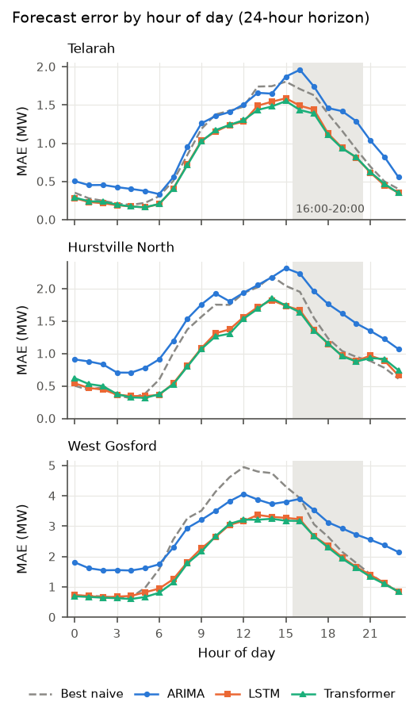
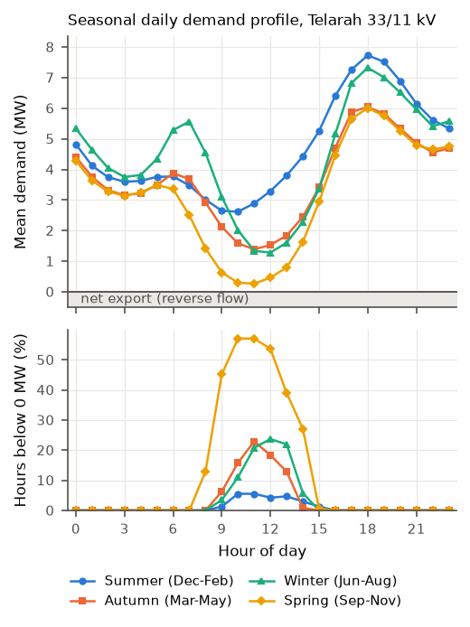

# Electricity Demand Forecasting from Ausgrid Substation Data

BEng (Honours) capstone research project, 41029 Engineering Research Preparation, UTS.

## The research in brief

Electricity networks have to be planned around demand, and rooftop solar has made demand harder to predict at the local level. This project asks:

> How can machine learning models, using multi-year substation load data, improve electricity demand forecasting and thus reliability in urban distribution networks?

To answer this, the project compares four kinds of forecaster on hourly data from Ausgrid zone substations:

- **Naive baselines**, such as "the same hour yesterday"
- **ARIMA**, the classical statistical approach
- **LSTM**, a recurrent neural network
- **Transformer**, an attention-based neural network

Each model forecasts 1 hour ahead (short-term operations) and 24 hours ahead (day-ahead planning). They are tested at three substations chosen to represent small, medium and large sites.

The project looks at more than average error. Being wrong during a summer evening peak matters far more than being wrong at 3am, and under-forecasting is riskier than over-forecasting. So peak-period error and forecast bias are measured as well, as stand-ins (proxies) for network reliability.

**Main findings:**

- The LSTM and Transformer beat every other model on average error at both horizons and at all three substations.
- The Transformer cut MAE by roughly 40% at 1 hour and 15 to 27% at 24 hours compared with the best naive baseline.
- The gap between the LSTM and Transformer is usually too small to be statistically meaningful.
- At 24 hours, the most accurate models on average are not always the best on the highest-demand hours. A simple naive forecast has the lowest error on those hours at two of the three substations.

## Results at a glance

Test-set MAE in MW (lower is better). The lowest value in each row is in bold.

| Substation | Horizon | Best naive | ARIMA | LSTM | Transformer |
|---|---:|---:|---:|---:|---:|
| Telarah 33/11 kV (small) | 1 h | 0.611 | 0.414 | 0.357 | **0.348** |
| Telarah 33/11 kV (small) | 24 h | 0.924 | 1.057 | 0.796 | **0.787** |
| Hurstville North 132/11 kV (medium) | 1 h | 0.709 | 0.472 | 0.447 | **0.429** |
| Hurstville North 132/11 kV (medium) | 24 h | 1.153 | 1.463 | **0.979** | 0.980 |
| West Gosford 132/11 kV (large) | 1 h | 1.251 | 0.845 | 0.739 | **0.711** |
| West Gosford 132/11 kV (large) | 24 h | 2.489 | 2.749 | 1.867 | **1.806** |

Some other results worth knowing:

- **Statistical significance.** Diebold-Mariano (DM) tests compare ARIMA, LSTM and Transformer in pairs, giving 18 tests. With a Bonferroni correction (p < 0.05/18 = 0.00278), 13 stay significant. Both deep models beat ARIMA in all 12 of those comparisons. For LSTM against Transformer, only Hurstville North at 1 hour survives the correction, in the Transformer's favour.
- **ARIMA at 24 hours.** ARIMA has a higher MAE than the best naive baseline at all three substations. Its MASE is also above 1 at 24 hours, as is the naive baseline's. The deep models are the only ones with a MASE below 1 at this horizon.
- **Bias at 1 hour.** During summer weekday evenings, ARIMA, LSTM and Transformer all under-forecast significantly often at every substation (58 to 71% of hours).
- **Bias at 24 hours.** The deep models show no significant bias at 24 hours. ARIMA significantly over-forecasts at Hurstville North and West Gosford.
- **Extreme hours.** Within the summer evening window at 24 hours, the Transformer under-forecasts about half of all hours overall, but all of the top 10% highest-demand hours. Its predictions cover a narrower range than the actual demand.
- **Reverse power flow.** 47 of the 153 substations that passed the quality checks recorded hours of negative net demand. The most extreme was Maryland 132/11 kV, negative in 20.4% of hours and reaching -13.85 MW.



*Error by hour of day at 24 hours. Error is highest from midday to mid-afternoon and lowest in the early morning. The shaded band marks the evening peak window.*



*Telarah's seasonal demand profile. Average demand never goes below zero, but negative hours are common at midday in spring (up to 57% of hours at 10:00 and 11:00) and much rarer in summer (under 6%).*

The full set of numbers is in [`results/metrics/chapter4_summary.md`](results/metrics/chapter4_summary.md).

## The data

The data is Ausgrid's public [distribution zone substation data](https://ausgrid.com.au/about-us/about-ausgrid/research-data-sets/distribution-zone-substation-data), which records load at 15-minute intervals. A copy of the CSV files is committed in `data/raw/`.

| Item | Value |
|---|---|
| Raw CSV files | 545 |
| Substations found | 194 |
| Substations processed | 180 |
| Passed the quality gate | 153 |
| Hourly rows | 3,593,184 |
| Study period | 1 January 2023 to 29 April 2025 |

The study starts in 2023 because the COVID-19 lockdown years distorted the mix of residential and commercial demand in ways that are unlikely to repeat.

The 14 substations dropped at the start only appear in the FY2023 files, so they have about four months of data inside the study period. The quality gate then requires at least 95% coverage and no more than 5% imputed hours.

### Choosing the three substations

The eligible substations were split into three equal groups by mean load (terciles), and the median site in each group was selected. This gives a fair spread of sizes without cherry-picking the cleanest or easiest sites.

| Substation | Group | Mean (MW) | Max (MW) | Min (MW) | Imputed hours | Negative hours |
|---|---|---:|---:|---:|---:|---:|
| Telarah 33/11 kV | Small | 4.02 | 17.08 | -2.42 | 2.9% | 4.5% |
| Hurstville North 132/11 kV | Medium | 10.08 | 25.71 | 2.35 | 3.6% | 0% |
| West Gosford 132/11 kV | Large | 20.46 | 53.46 | 2.65 | 3.1% | 0% |

### Train, validation and test splits

The splits are strictly chronological, so a model is never trained on data from after the period it is tested on.

| Split | From | To | Hours per substation |
|---|---|---|---:|
| Train | 1 Jan 2023 | 17 Aug 2024 | 14,264 |
| Validation | 17 Aug 2024 | 22 Dec 2024 | 3,056 |
| Test | 22 Dec 2024 | 29 Apr 2025 | 3,080 |

## What the code does

### 1. Preprocessing (`src/ausgrid_pipeline/`)

| File | Job |
|---|---|
| `ingest.py` | Reads the wide CSV exports and turns them into a long, timestamped series. Handles the inconsistent labels and date formats between files. |
| `clean.py` | Runs quality checks, removes duplicate timestamps, averages to hourly, fills gaps and flags outliers. |
| `features.py` | Adds calendar features, NSW public holidays, lags and rolling statistics, then applies the splits and scaling. |
| `stream.py` | Runs the whole pipeline one substation at a time, so 545 files don't need to fit in memory at once. |
| `config.py` | Holds every setting in one place, so it doubles as a parameter table. |

A few decisions here are worth explaining:

- **Gap filling has two tiers.** Linear interpolation fills up to 3 missing hours, and the substation's median for that hour of the week fills longer gaps.
- **Suspect data is flagged, not deleted.** Imputed and outlier hours stay in the data so the effect of cleaning can be measured, but they are never used as evaluation targets.
- **Negative load is kept.** It is real rooftop solar export, not an error.
- **Outliers are judged locally.** The test uses a rolling median absolute deviation over one week. A single threshold for the whole year would remove genuine summer peaks, which are exactly what this project needs to study.

### 2. Models (`src/models/`)

| File | Model | Details |
|---|---|---|
| `baselines.py` | Naive baselines | Persistence, seasonal naive (daily and weekly) and a drift-adjusted weekly version. |
| `arima.py` | ARIMA(3,0,2) | Regression with ARIMA errors. Fourier terms capture the daily and weekly cycles, plus weekend and holiday indicators. Fitted once on the training data, then rolled through the test period without refitting. |
| `lstm.py` | LSTM | 64 hidden units, 1 layer. Also contains the window-building code used by both deep models. |
| `transformer.py` | Transformer | 48-dimensional encoder, 1 layer, 4 attention heads, fixed positional encoding. |

The comparison between the deep models is designed to be controlled:

- Both go through `scripts/run_deep.py` with the same data windows, splits, scaler, optimiser (Adam, learning rate 0.001), loss (MAE), batch size (256) and early stopping (patience of 5, up to 40 epochs).
- Only the encoder differs.
- They have about the same capacity (LSTM 23,937 parameters, Transformer 23,153), so one model isn't simply bigger than the other.
- Each is trained with 3 random seeds and the predictions are averaged. The spread across seeds is reported because run-to-run variation can be as large as the gap between models.

Each sample uses a one-week (168-hour) input window of scaled load and calendar features, plus the calendar features of the target hour.

Separate models are trained for each substation and horizon, and no weather data is used.

### 3. Evaluation (`src/evaluation/metrics.py`)

| Group | Metrics | Purpose |
|---|---|---|
| Accuracy | MAE, RMSE, MAPE, MASE | Average forecast error |
| Peak error | Peak MAE, peak RMSE | Error during the top 5% of hours by actual load |
| Peak bias | Under-forecast rate with a binomial test against 50% | Whether a model leans low in a fixed peak window |
| Significance | Diebold-Mariano test | Whether a difference between two models is real or just noise |

Two details here are easy to misread:

- **There are two definitions of "peak", on purpose.** Peak error uses the top 5% of hours by actual load. Peak bias uses a window fixed by the clock: December to February, weekdays, 16:00 to 20:00. If bias were measured on the highest actual loads, every imperfect model would appear to under-forecast, simply because those hours were selected for being extreme. Fixing the window in advance avoids this.
- **MASE is more useful than MAPE on this data.** MAPE divides by actual load, and at substations where net load passes through zero the percentages blow up. Telarah's MAPE is over 100% for some models for this reason. MASE instead compares against the in-sample error of a seasonal naive forecast, so a value below 1 beats that benchmark.

### 4. Avoiding data leakage

Leakage produces results that look impressive and aren't real, so several safeguards are built in:

- A forecast for time t+h can only use data up to time t, and the baselines refuse to run if their lag breaks this rule.
- Rolling features are shifted so they exclude the current hour.
- Scaling values are calculated from the training split only.
- `assert_no_leakage` checks the window alignment before any deep model trains.

## Repository organisation

```
.
├── data/
│   ├── raw/                        Ausgrid CSV exports
│   └── processed/
│       ├── hourly_features/        One parquet file per substation
│       ├── qc_report.csv           Data quality report per substation
│       └── scaler_params.json      Training-split scaling values
├── src/
│   ├── ausgrid_pipeline/           Preprocessing package
│   ├── models/                     Baselines, ARIMA, LSTM, Transformer
│   └── evaluation/                 Metrics and significance tests
├── scripts/                        Command-line entry points (see below)
├── tests/                          pytest suite
├── results/                        Final results
│   ├── metrics/                    Result tables, predictions, summaries
│   └── figures/                    All figures
├── results_old_labelling/          Original run, kept for comparison
├── results_labelling_fix_only/     Intermediate run, kept for comparison
├── substation_coverage.csv         Date coverage per substation
├── Makefile                        Shortcuts for inspect, preprocess, test
└── requirements.txt
```

The `configs/`, `docs/` and `notebooks/` folders are currently empty. Settings live in `src/ausgrid_pipeline/config.py` and in each script's command-line arguments.

### Scripts

| Script | What it does |
|---|---|
| `inspect_data.py` | Reports on the raw files (resolution, labelling, coverage) using only headers and identifier columns. |
| `run_preprocessing.py` | Builds the hourly modelling dataset. |
| `run_eda.py` | Produces exploratory figures, the stationarity tests and the substation selection. |
| `run_baselines.py` | Evaluates the naive baselines. |
| `run_arima.py` | Fits and evaluates ARIMA. |
| `run_deep.py` | Trains and evaluates the LSTM or Transformer. |
| `run_comparison.py` | Combines all results into comparison tables, DM tests and figures. |
| `make_report_figures.py` | Creates the four report figures (`fig_*.png`). |
| `make_chapter4_summary.py` | Collects every number the results chapter needs into one markdown file. |
| `compare_labelling_fix.py` | Compares two complete runs: metrics, rankings, DM verdicts and network counts. |
| `recompute_metrics.py` | Recalculates metrics from saved predictions without retraining. Useful if a metric definition changes. |
| `run_lstm.py` | The earlier LSTM-only script, replaced by `run_deep.py`. |
| `show_nlags.py` | Quick autocorrelation check for Hurstville at lags from 1 to 8 days. |

## Running it

### Setup

The results were produced with Python 3.12.

```bash
python3 -m venv .venv
```

```bash
source .venv/bin/activate
```

```bash
pip install -r requirements.txt
```

`requirements.txt` doesn't currently list a few packages the scripts need, so install these as well:

```bash
pip install matplotlib statsmodels tabulate pytest
```

### Reproducing the results

Run these from the repository root, in this order. Each stage relies on the outputs of the stages before it.

```bash
python scripts/inspect_data.py --input data/raw
```

```bash
python scripts/run_preprocessing.py --input data/raw --output data/processed --start-date 2023-01-01 --end-date 2025-04-29 --stream
```

```bash
python scripts/run_eda.py
```

```bash
python scripts/run_baselines.py
```

```bash
python scripts/run_arima.py --order 3,0,2
```

```bash
python scripts/run_deep.py --model lstm
```

```bash
python scripts/run_deep.py --model transformer
```

```bash
python scripts/run_comparison.py
```

```bash
python scripts/make_report_figures.py
```

```bash
python scripts/make_chapter4_summary.py
```

Approximate run times on a 16-core CPU with no GPU:

| Step | Time |
|---|---:|
| Preprocessing | 80 seconds |
| ARIMA | 14 minutes |
| LSTM | 16 minutes |
| Transformer | 2.5 hours |

Some things to keep in mind:

- **Preprocessing overwrites its output.** It deletes and rebuilds `data/processed/hourly_features/`.
- **Keep the `--stream` flag.** Without it, the pipeline writes a single parquet file instead of the folder the other scripts expect.
- **Training code runs on the CPU.** It doesn't move models or tensors to a GPU, so a GPU won't speed up training without changing the code.
- **Results are close, not identical.** Retraining the LSTM on one test case reproduced its MAE to within 0.4%, but CPU training isn't exactly repeatable across environments.
- **Test the harness first.** `python scripts/run_deep.py --model lstm --backend ridge` swaps the network for a fast linear model. This checks that everything is wired up before committing to hours of training. Its output goes to `results/metrics/smoke_test_results.csv` and is not a research result.
- **`make clean` is destructive.** It deletes everything in `data/processed/` and `results/metrics/`.

### Tests

```bash
python -m pytest tests/ -q
```

There are 26 tests, and all of them pass. `test_preprocessing.py` (18 tests) covers things that fail silently, such as timestamp labels landing on the wrong day. `test_transformer_capacity.py` (8 tests) checks that the two deep models stay within 10% of each other in size.

## Two problems found in the raw data

Both of these were found late in the project, by following up odd-looking values in the results. They are probably the most useful lesson from the project: bad data doesn't crash a pipeline, it just produces plausible numbers.

### The FY2024 timestamp bug

Ausgrid labels each reading by the time its interval ends, so a day runs from 00:15 to 24:00. All 176 FY2024 files instead name that last column `00:00`. The pipeline originally read this as the start of the day, which caused two errors across May 2023 to April 2024:

- Every timestamp in those files was 15 minutes late.
- Each day's final reading was placed 24 hours early, so it was mixed into the first hour of that same day.

To confirm the fix, each trailing value was tested both ways. Read as the end of the day, it joins smoothly to the next day's first reading (median step of 0.25 MW). Read as the start of the day, the median step is 0.65 MW. The end-of-day reading fits better in all 176 files.

`interval_map()` in `ingest.py` now handles this, and `inspect_data.py` reports all 545 files as using one labelling convention.

### Blank-day placeholders

When a day has no data, the export contains an empty row with a lone `0.0`. It looks like a reading but isn't one. There are 261 of these rows in the archive. Left in, they create isolated one-hour drops to 0 MW, which badly affected ARIMA. Masking just the five at Hurstville North brought its 1-hour MAE back from 0.486 to 0.472 MW.

`file_to_long()` now treats these rows as missing. Days with one real non-zero reading are kept, since those values match the neighbouring days.

### Effect on the results

The three results folders record each stage, so the effect of each fix can be seen separately:

| Folder | What it contains |
|---|---|
| `results_old_labelling/` | The original run |
| `results_labelling_fix_only/` | With the timestamp fix |
| `results/` | With the timestamp fix and the placeholder masking (final) |

Compared with the original run:

- Baselines moved by less than 0.03%.
- LSTM and Transformer MAE moved by -1.7% to +2.1%.
- The same three substations were selected.
- One of the six model rankings changed, with the LSTM and Transformer swapping places at Hurstville North at 24 hours, where they are statistically indistinguishable.

The full comparisons are in [`labelling_fix_comparison.md`](results/metrics/labelling_fix_comparison.md) and [`placeholder_mask_comparison.md`](results/metrics/placeholder_mask_comparison.md).

## Limitations

- **ARIMA at 24 hours is still unexplained.** After the fixes, its MAE rose by 14% at Hurstville North and 8% at West Gosford, and it now over-forecasts by about 0.4 and 0.8 MW. This isn't caused by the optimiser, by small changes to the training window or by the placeholders, and the exact cause hasn't been identified. Results for this model and horizon should be read with that in mind.
- **ARIMA fitting stops before converging.** `ArimaForecaster.fit()` uses the default iteration limit and hides the warning. Running to convergence made little difference to the Hurstville North and West Gosford results, but this should be tidied up.
- **The test period doesn't cover a full year.** It runs from late December to late April, so there is no winter peak in the test set.
- **Only three substations were modelled.** They were chosen to be typical of their size groups, but results may not carry over to the whole network.
- **There is no weather data.** Temperature is a major driver of peak demand and would be the first thing to add. `features.py` already has support for joining a weather file.
- **The MASE scale is slightly approximate.** Imputed and outlier hours are removed before the 24-hour differences are taken, so a few lags aren't exactly 24 hours apart. The same scale is used for every model at a substation, so comparisons between models are not affected.
- **Reliability is measured by proxy.** Peak error and bias indicate operational risk, but they aren't direct measures of network reliability such as outages.

## Future work

- Find the cause of the ARIMA 24-hour shift.
- Add temperature and other weather inputs.
- Extend the test period to include a winter.
- Train across multiple substations, rather than one model per site.
- Use a loss function that penalises under-forecasting at peaks more heavily, to address the bias at 1 hour and on extreme hours.
